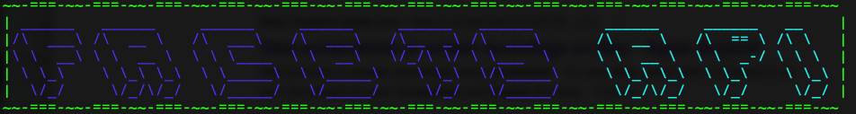
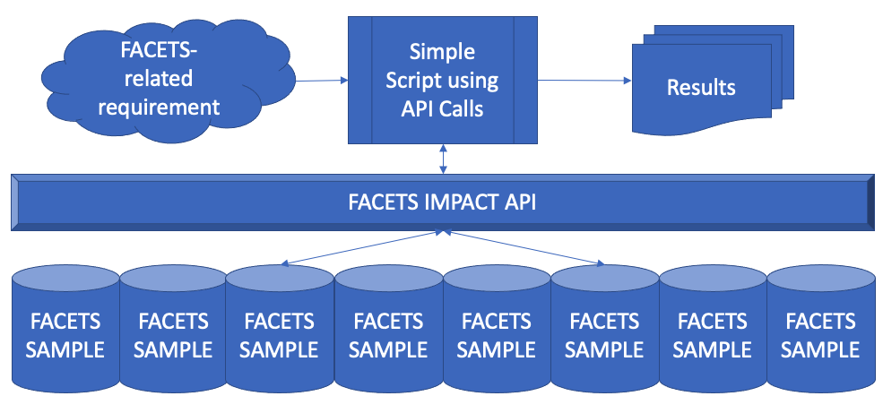
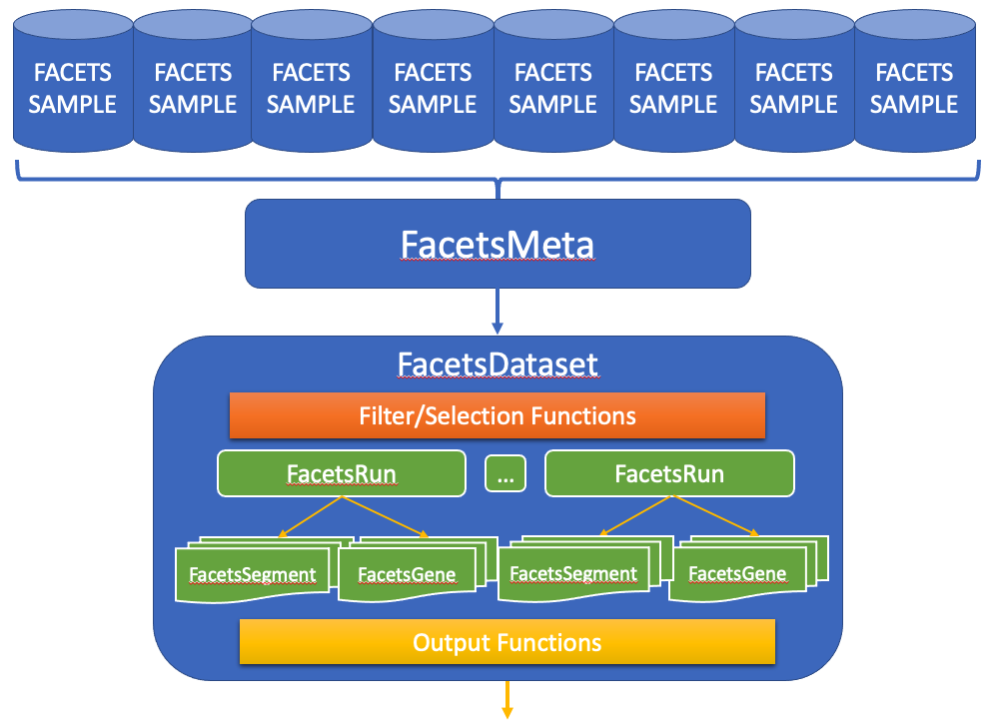

#  

---

#### Quick Links
* [Installation](doc/installation.md)
* [API Reference Documentation](doc/README.md)
* [Configuration (R tools, environment variables, exceptions)](doc/configuration.md)
* [Example Scripts & Use Cases](doc/examples.md)

---

## Background 

FacetsAPI is a python package for interacting with and manipulating Impact FACETS data at MSKCC.  

The Impact FACETS data repository represents a standardized file structure that we expect to be consistent across all samples. The primary Impact FACETS repository lives on the MSK cluster (`.../ccs/shared/resources/impact/facets/all/`, with the 2n repository beside it under `impact_2n`), however this API can be directed to work with any standardized FACETS file system, mounted at any path.

In the file structure state, information about a sample is spread over many files. Meaning that if you want to work with FACETS data, you must know the details of the file structure and contents.  Additionally, the large number of sample stored in the FACETS data repository is cumbersome to work with when gathering samples with specific properties, leading to extensive manual cross-referencing and data manipulation that is time consuming and subject to human error.

 

FacetsAPI exists as an interactive layer between the user and the data, making working with FACETS data a more intuitive and quick process.

# Design

FacetsAPI provides a framework for interacting with this FACETS data, allowing users to specify specific conditions or to apply advanced operations directly to facets data without needing to have extensive experience in the distributed FACETS file structure, and without extensive manual interaction.  It incorporates a generalized design that allows it to address a variety of potential use-cases.

 

FACETS files contain a variety of files detailing segments, copy number alteration, QC, gene level data, and a variety of other useful information.  FacetsAPI structures this data into an object-oriented set of classes that work holistically to provide a structured way to work with the data.  

# What changed in 0.6.0

* **2n repositories are supported.** Pairs with `clinical/` and `research/` fit sets are detected automatically; `FacetsMeta(..., fit_class="clinical"|"research"|"both")` chooses what to load (default `research`). Standard repositories are unaffected. See [FacetsMeta](doc/facetsmeta.md).
* **Fit selection is tiered and configurable.** Human-reviewed fits first, then autoQC fits (`auto_qc_best_fit`, `auto_qc_pass`, previously ignored), then the default fit; `FitPolicy.reviewed_only()` / `autoqc_only()` / `default_only()` restrict to one tier. `setSingleRunPerSample(True, allowDefaults)` keeps working and maps onto the policy. To reproduce the pre-0.6 selection exactly use `FitPolicy.reviewed_only()` with `allowDefaults`.
* **Fit directories are resolved from the discovered sample directory**, not from the absolute `path` recorded inside `facets_review.manifest`. The repository can be mounted at any path (containers, laptops). Manifests with or without the leading `#` comment line are accepted.
* **Errors are exceptions, not `sys.exit()`.** All derive from `FacetsAPIError`; see [Configuration](doc/configuration.md#exceptions). Scripts that relied on a silent exit now see a traceback.
* **Copy-number calls are correct.** `FacetsRun.get_cn_call(tcn, lcn)` used a table keyed on major copy number; it is now keyed on lesser copy number and returns real calls (it mostly returned `None` before).
* **R tools are configuration driven.** `ExtTools` / `FPTools` take a `FacetsConfig` (or `FACETSAPI_*` environment variables) and run `Rscript` inline through one `bash -lc` command; `loadModule()` and `bsub` submission are gone (the old `module load` never reached the R call). The R wrapper takes the facetsPreview library path as an argument.
* Per-instance state: `hisens_vs_purity`, single-run flags, `failed_samples` and verbosity are no longer shared between FacetsMeta objects (hisens mode used to read purity cvals). `setVerbose(True)` now works.
* `MetaDictMap.FIT_CLASS` (14) and `FIT_TIER` (15); `FacetsRun.fit_class`; `FacetsMeta.build_counts`; `writeDatasetSummary(outdir=)`, `createHistogram(..., outdir=)`; two hardcoded sample ids removed from `writeAlterationData`; `rpy2` dropped from dependencies, `numpy`/`matplotlib` added; a unit-test suite on a synthetic repository (`python -m unittest discover -s tests -p 'test_*.py'`).
